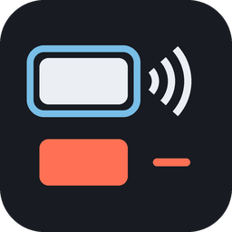

#  XamlA11y

**Static accessibility audit for WPF XAML. Finds controls a screen reader cannot name and things a keyboard cannot reach — without launching the app — and fails CI on new ones.**

[](https://www.nuget.org/packages/Cornhsu.XamlA11y)
[](LICENSE)

[繁體中文](README.zh-Hant.md)

```bash
dotnet tool install -g Cornhsu.XamlA11y

xamla11y audit ./src                                    # look at what is there
xamla11y audit ./src --write-baseline a11y-baseline.json   # accept today's findings
xamla11y audit ./src --baseline a11y-baseline.json         # from now on, fail only on new ones
```

> Requires the **.NET 10 runtime**. Reads XML, not WPF: it runs on Linux, Windows and macOS.
> The tool is **0.x**: pin the version, a release can change which findings you get.
>
> **WPF only.** WinUI/UWP, Avalonia and MAUI files are recognised and reported as *not checked*.

**On an existing project, the second line comes before CI.** Most WPF projects have never named a single input, so the
first run can list dozens of findings. A gate that is red from day one gets switched off; the baseline
lets you stop the number from growing and pay it down when you touch each view.

---

## What it finds

### Not read out

| Finding | WCAG 2.2 (level) | Default | |
|---|---|---|---|
| `missing-name` | 4.1.2 (A), 1.1.1 (A) | fail | A button, check box, tab, menu item… that has no name for a screen reader to say. **A ToolTip is not a name** — WPF exposes it as the help text. |
| `text-not-in-name` | 4.1.2 (A), 2.5.3 (A) | fail | It *shows* text, but the text is inside a `StackPanel`, `Border` or `AccessText`. WPF only takes the name from a string, a `TextBlock` or a `ContentControl`. |
| `meaningless-name` | 4.1.2 (A), 1.1.1 (A) | fail | The name is an icon-font character, white space, `System.Windows.Controls.TabItem`, or geometry path data. |
| `input-no-name` | 4.1.2 (A), 1.3.1 (A) | fail | A `TextBox`, `PasswordBox`, `RichTextBox`, `ComboBox`, `Slider` or `DatePicker` nothing names. **`<Label Target=…>` does not name it** — see below. |
| `list-no-name` | 4.1.2 (A), 1.3.1 (A) | warn | A `ListBox`, `ListView`, `TreeView` or `DataGrid` nothing names. The `GroupBox` around it does not. |
| `widget-no-name` | 4.1.2 (A) | warn | The same for a `ProgressBar` or a `Calendar` (a `Menu` or `ToolBar`: info). |
| `item-type-name` | 4.1.2 (A) | warn | Items made from data are read as `MyApp.Models.Note`: the class has no `ToString()` and no container style sets the name. **`DisplayMemberPath` does not name them.** |
| `silent-tab-stop` | 4.1.2 (A) | warn | Tab stops there and a screen reader says nothing: a `ContentControl` without `Focusable="False"`, or your own control without an AutomationPeer. |
| `symbol-name` | 1.1.1 (A) | info | Named only `×`, `…` or an emoji. |
| `same-name` | 2.4.6 (AA) | info | Controls side by side with the same name that do different things. |

### Out of reach of the keyboard

| Finding | WCAG 2.2 (level) | Default | |
|---|---|---|---|
| `mouse-only` | 2.1.1 (A) | fail | A `Border`, `Image`, `TextBlock`… with a click handler and no keyboard way in. |
| `not-in-tab-order` | 2.1.1 (A) | warn | `IsTabStop="False"` or `Focusable="False"` on a control with no access key, `IsDefault`/`IsCancel` or other visible way in. |

### Focus not visible

| Finding | WCAG 2.2 (level) | Default | |
|---|---|---|---|
| `focus-not-visible` | 2.4.7 (AA) | fail | `FocusVisualStyle` removed, and neither the template nor any style draws focus instead. Reported once, at the setter. |

### Too small

| Finding | WCAG 2.2 (level) | Default | |
|---|---|---|---|
| `small-target` | 2.5.8 (AA) | warn | A size *you set* under 24 DIP, too close to its neighbour for the spacing exception. |

`xamla11y rules` prints the same list with the fix for each; before and after for every one: [docs/fixes.md](docs/fixes.md).

The standard is **WCAG 2.2, levels A and AA**: eight of its 55 criteria, read for desktop software as
[WCAG2ICT](https://www.w3.org/TR/wcag2ict-22/) says. Why each finding is that criterion, when it is not a violation, how
EN 301 549, Section 508 and Taiwan's rules differ, and what a person still has to check:
[docs/standards.md](docs/standards.md). `--standard` and `--level` choose another one (WCAG 2.1 or 2.0, EN 301 549, Section 508); the
HTML, JSON and SARIF reports also carry the clause numbers of EN 301 549 and Section 508.

This is **not** a claim of WCAG, EN 301 549 or European Accessibility Act conformance. A static tool
sees part of what those ask for, and only part of that is decided by XAML.

## `Label.Target` does not label anything

This is the most common surprise, so it gets its own heading. In WPF

```xml
<Label Content="_Name" Target="{Binding ElementName=NameBox}"/>
<TextBox x:Name="NameBox"/>
```

gives the access key a target and **gives the TextBox no accessible name**. Measured with a UI Automation
client on .NET Framework 4.8 and .NET 8, 9, 10 and 11; Axe-Windows reports it too. Write this instead:

```xml
<Label x:Name="NameLabel" Content="_Name" Target="{Binding ElementName=NameBox}"/>
<TextBox x:Name="NameBox" AutomationProperties.LabeledBy="{Binding ElementName=NameLabel}"/>
```

Watermarks do not name a field either (MahApps.Metro 2.4, HandyControl 3.5, WPF-UI 4.3) — with one
exception: MaterialDesignThemes 5.3 turns `HintAssist.Hint` into the name, and the tool knows that.

## Example

`samples/demo` is broken on purpose:

```
xamla11y audit — 1 XAML file(s), WCAG 2.2 A + AA
  6 fail, 7 warn, 2 info
    not read out: 10 (missing-name 1, text-not-in-name 1, meaningless-name 1, input-no-name 1, list-no-name 1, widget-no-name 1, item-type-name 1, silent-tab-stop 1, symbol-name 1, same-name 1)
    out of reach of the keyboard: 2 (mouse-only 1, not-in-tab-order 1)
    focus not visible: 1 (focus-not-visible 1)
    too small: 2 (small-target 2)
  resolution 93.8% (24 judged, 1 unknown; 1 left out)
  suppressed: 1

  fail focus-not-visible  MainWindow.xaml:11
       The style 'FlatButton' removes FocusVisualStyle and nothing else shows keyboard focus: its template has no focus trigger and no Focused state
  fail missing-name       MainWindow.xaml:26   NVDA: "button, Delete"
       <Button> has no accessible name: its content is <Path>, which gives no text; its ToolTip is the help text, not the name
  fail text-not-in-name   MainWindow.xaml:31   NVDA: "button"
       <Button> shows "Save" but has no accessible name: the text is inside <StackPanel>; WPF only takes the name from a string, a TextBlock or a ContentControl
  fail meaningless-name   MainWindow.xaml:39
       <Button> has an unreadable accessible name (U+E74D): its name is an icon-font character from the private use area
  fail input-no-name      MainWindow.xaml:46   NVDA: "edit"
       <TextBox> has no accessible name; <Label Target> at line 45 does not give it one (use AutomationProperties.LabeledBy)
  fail mouse-only         MainWindow.xaml:49
       <Border> reacts to MouseLeftButtonUp (OnOpen) but the keyboard cannot reach it
  … then warn, info, what it could not judge and the checks a person has to do
```

## How far to trust it

- **Every rule was compared with the real thing.** Some 21,000 answers, against real WPF windows, a UI Automation client, pixels,
  Axe-Windows and NVDA: no contradictions. The recorded answers ship with the tests, so CI checks them on every change.
- **It says how much it could see.** *Resolution* is the share of elements it could judge, of those that should get an answer. Below `--min-coverage`
  (60) the run exits 3, *not trustworthy*, rather than 0. Of 49 public projects and 3 apps, 38 are above 85% without
  any configuration; controls of a library nobody has told it about stay unknown until you declare them with
  [`treatAs`](docs/config-schema.md).
- **"NVDA says" is only written for what was run.** Narrator and JAWS were not.

The numbers, project by project: [docs/verification.md](docs/verification.md).

**What it cannot see**

- Names, content and handlers set in code. It reads a XAML file's *own* code-behind, only to notice that
  it sets a control's name or content (the control is then unknown, not missing) and that a handler just drags the window.
- Implicit styles that reach into a `UserControl` from the resources of the window that hosts it.
- Names from data. Of items generated from `ItemsSource` it sees whether anything names them, not what the name is.
- Reading order, live regions, high contrast, whether a name is a *good* name, whether an image is decorative.
- An `ItemsControl` without a name (Axe-Windows reports it; it is mostly layout). Commercial control libraries (Telerik, DevExpress,
  Syncfusion…): nothing of theirs was measured, so they are unknown.
- Target size where the size or the neighbours are decided at run time: not judged.

## Options

| | |
|---|---|
| `--html <file>` | one page for people, without scripts or external files: what, why, how to fix, what NVDA says, the clause numbers, and the checks a person has to do |
| `--json`, `--sarif`, `--md <file>` | full report, code scanning, Markdown for a PR comment |
| `--standard <id>`, `--level A\|AA` | `wcag22` (default), `wcag21`, `wcag20`, `en301549` (V3.2.1), `en301549-v4`, `section508` — [what changes](docs/standards.md#choosing-one) |
| `--lang en\|zh-Hant` | language of the console, Markdown and HTML reports. JSON, SARIF and MSBuild stay English |
| `--msbuild` | MSBuild diagnostics for the Visual Studio error list: `XA0001` gated, `XA0002` not gated, `XA0003` not trustworthy |
| `--baseline`, `--write-baseline <file>` | only fail on new findings. Keys contain no line numbers |
| `--fail-on fail\|warn` | lowest severity that fails the run |
| `--min-coverage <0-100>` | exit 3 below this resolution |
| `--config <file>` | default `xamla11y.config.json` in the root — [schema](docs/config-schema.md) |
| `--exclude <text>` | skip paths that contain this |

Exit codes: **0** pass · **1** findings at or above `--fail-on` · **2** usage, config or input error ·
**3** result not trustworthy.

To accept one element, put a comment with a reason right before it. Other comments may sit in
between; another element or text may not. Without a reason, or in front of text or a commented-out element, it
does nothing and the run says so:

```xml
<!-- xamla11y-ignore: the whole row is the control, this check box only mirrors it -->
<CheckBox IsChecked="{Binding IsSelected}"/>
```

## GitHub Action

```yaml
permissions:
  contents: read
  pull-requests: write     # for the PR comment
  # security-events: write # for sarif: true

steps:
  - uses: actions/checkout@v4
  - uses: HSU-YU-MING/cornhsu-xamla11y@v0.1.0
    with:
      root: src
      version: 0.1.0
      baseline: a11y-baseline.json
```

Findings are annotated on their lines (GitHub shows the first ten or so per step; the report has all of them), the Markdown report becomes one PR comment that is updated in
place, the JSON report is uploaded as an artifact, and the job fails last, after all of that is out.

| Input | Default | |
|---|---|---|
| `root` | `.` | folder to scan |
| `working-directory` | `.` | `root`, `config` and `baseline` are relative to it |
| `version` | latest | tool version; pin it |
| `config` | file in root | `xamla11y.config.json` |
| `baseline` | | committed baseline file |
| `fail-on` | `fail` | `fail` or `warn` |
| `min-coverage` | config, else `60` | |
| `comment` | `true` | post the report on the PR |
| `upload-report` | `true` | upload JSON and Markdown as an artifact |
| `sarif` | `false` | upload to code scanning |
| `artifact-name` | `xamla11y-report` | also keys the PR comment |

## With XamlContrast, XamlKeys and XamlFit

| | asks |
|---|---|
| [XamlContrast](https://github.com/HSU-YU-MING/cornhsu-xamlcontrast) | can you see it? (colour contrast) |
| [XamlKeys](https://github.com/HSU-YU-MING/cornhsu-xamlkeys) | can it be found? (resource keys) |
| [XamlFit](https://github.com/HSU-YU-MING/cornhsu-xamlfit) | does it fit? (text width) |
| **XamlA11y** | can you reach it, and can it be read out? |

Same exit codes, same action inputs, separate report files, artifacts, PR comments and SARIF tools, so the
four can run in one job: [docs/four-tools.md](docs/four-tools.md). A missing `{StaticResource}` behind an
`AutomationProperties.Name` is XamlKeys' finding; XamlA11y treats the name as present.

## Compared with

- **Accessibility Insights for Windows, Visual Studio's Accessibility Checker** — both run Axe-Windows on a
  *running* app, so they see what static analysis cannot (data, code, real sizes) and only the screens
  somebody opened. Use both.
- **[Bennewitz.Ninja.XamlQuality](https://github.com/JanusMael/Bennewitz.Ninja.Inspections)** — rules you
  call from a test project, mainly for Avalonia. It asks for an explicit `AutomationProperties.Name` on
  every interactive control; XamlA11y follows how WPF computes names, so a button with text is fine as it is.

## License

MIT. See [THIRD-PARTY-NOTICES.md](THIRD-PARTY-NOTICES.md).
