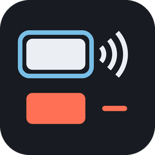

#  XamlA11y

**WPF XAML 的靜態無障礙稽核。不開 App 就找出螢幕閱讀器念不出名字、鍵盤到不了的地方，並在 CI 擋住新增的。**

[English](README.md)

```bash
dotnet tool install -g Cornhsu.XamlA11y

xamla11y audit ./src                                    # 先看有什麼
xamla11y audit ./src --write-baseline a11y-baseline.json   # 把今天的記成已知
xamla11y audit ./src --baseline a11y-baseline.json         # 之後只擋新增的
```

> 需要 **.NET 10 runtime**。只讀 XML、不相依 WPF，Linux、Windows、macOS 都能跑。
> 還在 **0.x**：請釘確切版本，新版可能改變你會拿到哪些結果。
>
> **只檢查 WPF。** WinUI／UWP、Avalonia、MAUI 的檔案會認出來並回報「沒檢查」。

**第一次請先 `--write-baseline`。** 多數 WPF 專案的輸入框一個名稱都沒寫，第一次跑會一口氣列出幾十筆。
一上來就紅的閘門會被關掉；先記成已知，之後不再變多、改到哪個畫面就順手修。

---

## 找什麼

| 種類 | WCAG 2.2（等級） | 預設 | |
|---|---|---|---|
| `missing-name` | 4.1.2 (A), 1.1.1 (A) | fail | 按鈕、核取方塊、頁籤、選單…，螢幕閱讀器沒有名稱可以念。**ToolTip 不是名稱**，WPF 把它當說明文字。 |
| `text-not-in-name` | 4.1.2 (A), 2.5.3 (A) | fail | 畫面上**有**字，但字在 `StackPanel`、`Border`、`AccessText` 裡。WPF 只從字串、`TextBlock`、`ContentControl` 取名稱。 |
| `meaningless-name` | 4.1.2 (A), 1.1.1 (A) | fail | 名稱是圖示字型的字元、空白、`System.Windows.Controls.TabItem`、或 Geometry 路徑。 |
| `input-no-name` | 4.1.2 (A), 1.3.1 (A) | fail | `TextBox`、`PasswordBox`、`RichTextBox`、`ComboBox`、`Slider`、`DatePicker` 沒有名稱。**`<Label Target=…>` 不會給名稱**（見下）。 |
| `focus-not-visible` | 2.4.7 (AA) | fail | `FocusVisualStyle` 關掉了，範本與樣式也沒有別的東西畫出焦點。報在關掉的那一行，一次。 |
| `mouse-only` | 2.1.1 (A) | fail | `Border`、`Image`、`TextBlock`… 掛了點按，鍵盤沒有路。 |
| `not-in-tab-order` | 2.1.1 (A) | warn | `IsTabStop="False"` 或 `Focusable="False"`，又沒有存取鍵、`IsDefault`／`IsCancel` 這些看得到的入口。 |
| `small-target` | 2.5.8 (AA) | warn | **你自己設的**大小小於 24 DIP，而且離鄰居太近、用不了間距例外。 |
| `list-no-name` | 4.1.2 (A), 1.3.1 (A) | warn | `ListBox`、`ListView`、`TreeView`、`DataGrid` 沒有名稱。外面包的 `GroupBox` 不算。 |
| `symbol-name` | 1.1.1 (A) | info | 名稱只有 `×`、`…` 或表情符號。 |

`xamla11y rules` 會印同一份清單與修法。

依據是 **WCAG 2.2 的 A 與 AA**：55 條裡的 7 條，照 [WCAG2ICT](https://www.w3.org/TR/wcag2ict-22/) 的方式套到桌面軟體。
每一種為什麼是那一條、什麼情況不算違反、跟 EN 301 549／Section 508／台灣規範差在哪、還有什麼要人來看：[docs/標準對照.md](docs/標準對照.md)。

這**不是** WCAG、EN 301 549 或歐盟無障礙法（EAA）的合規聲明：靜態工具只看得到其中一部分。

## `Label.Target` 不會給名稱

最常見的誤會，所以獨立一節。下面的寫法只讓存取鍵有目標，**TextBox 還是沒有無障礙名稱**：

```xml
<Label Content="_Name" Target="{Binding ElementName=NameBox}"/>
<TextBox x:Name="NameBox"/>
```

在 .NET Framework 4.8 與 .NET 8、9、10、11 用 UI Automation client 實測，Axe-Windows 也會報。要這樣寫：

```xml
<Label x:Name="NameLabel" Content="_Name" Target="{Binding ElementName=NameBox}"/>
<TextBox x:Name="NameBox" AutomationProperties.LabeledBy="{Binding ElementName=NameLabel}"/>
```

浮水印也不會變成名稱（MahApps.Metro 2.4、HandyControl 3.5、WPF-UI 4.3）；唯一的例外是
MaterialDesignThemes 5.3 會把 `HintAssist.Hint` 當名稱，工具認得。

## 怎麼知道的

規則照 WPF **實際怎麼做**寫，而且每一條都跟真的 WPF 比：`prototype/UiaOracle` 把 XAML 開成真的視窗，從另一條執行緒的
UI Automation client 讀樹（螢幕閱讀器看到的）、走 Tab、移動焦點比像素、跑 Axe-Windows。

| 跟什麼比 | 案例 | 有答案 | 不知道 | **說錯** |
|---|---:|---:|---:|---:|
| UIA 名稱，手寫 | 325 | 310 | 15 | **0** |
| UIA 名稱，控制項 × 內容 × 命名方式的窮舉 | 8,218 | 7,843 | 375 | **0** |
| UIA 名稱，19 個真實專案裡的不同形狀 | 2,172 | 2,172 | 0 | **0** |
| UIA 名稱，49 個公開專案與 3 個 App 的整個檔案（連樣式與資源） | 10,398 | 10,398 | – | **0** |
| MahApps、MaterialDesign、HandyControl、WPF-UI、Fluent 底下的名稱 | 97 | 74 | 23 | **0** |
| 焦點看得見（像素），預設與五個佈景 | 107 | 84 | 23 | **0** |
| Tab 順序 | 29 | 27 | 2 | **0** |
| 點擊範圍（BoundingRectangle） | 17 | 10 | 7 | **0** |

整個檔案那一列是不執行專案程式碼就載得進真的 WPF 的 1,919 個檔；要靠它的程式碼、沒量過的佈景、要打開選單才看得到的元素不算在內。

「不知道」是對的答案；把念不出名字的說成沒問題才是錯的。WPF 的答案錄在 `tests/XamlA11y.Tests/uia-facts.json`，
CI 在 Linux 上也比同一份。細節在 [docs/M1-UIA實測.md](docs/M1-UIA實測.md)。

## 老實說看得到多少

**可解析率** = 該有答案的元素裡，真的判得出來的比例。每次都印，`--min-coverage`（預設 60）當閘門：
低於它是 exit 3「結果不可信」，不是 0。名稱來自資料的（`Content="{Binding Title}"`）會數出來，但不進分母。

不設定、直接跑（後面幾欄是 finding 數。公開專案的 commit 釘在 [docs/corpus.tsv](docs/corpus.tsv)，連 C# 一起讀；
沒有 C# 的話 ScreenToGif 是 36% 而不是 99%，因為跟不到 `class ExtendedButton : Button`）。
可解析率只算會擋建置的四條（名稱、輸入框、焦點、只能用滑鼠），另外三條幾乎不會卡住，算進來只會墊高數字：

| 專案 | XAML 檔 | 可解析率 | 控制項名稱 | 輸入框 | 焦點 | 只能用滑鼠 | Tab、大小（警告） | 清單（警告） |
|---|---:|---:|---:|---:|---:|---:|---:|---:|
| Cornea (作者的 App) | 5 | **100.0%** | 0 | 19 | 0 | 0 | 0 | 1 |
| Kindling (作者的 App) | 16 | **100.0%** | 7 | 17 | 0 | 1 | 0 | 1 |
| QuillNest (作者的 App) | 32 | **99.5%** | 65 | 81 | 0 | 3 | 0 | 10 |
| Accessibility Insights | 71 | **59.4%** | 2 | 5 | 0 | 2 | 10 | 2 |
| BetterGI | 153 | **97.7%** | 430 | 551 | 0 | 1 | 8 | 20 |
| Bloxstrap | 40 | **89.9%** | 46 | 25 | 0 | 0 | 0 | 6 |
| dnGrep | 72 | **100.0%** | 53 | 90 | 0 | 0 | 0 | 4 |
| dnSpy | 124 | **99.3%** | 139 | 1365 | 0 | 1 | 94 | 42 |
| Dopamine | 150 | **38.5%** | 67 | 38 | 4 | 2 | 0 | 11 |
| EarTrumpet | 12 | **71.9%** | 11 | 9 | 0 | 0 | 8 | 10 |
| Flow.Launcher | 393 | **80.6%** | 28 | 107 | 0 | 3 | 4 | 17 |
| GeekDesk | 33 | **89.1%** | 14 | 23 | 0 | 2 | 0 | 7 |
| HandBrake | 58 | **100.0%** | 30 | 85 | 0 | 3 | 3 | 20 |
| MAA | 89 | **89.1%** | 68 | 165 | 0 | 4 | 1 | 24 |
| NETworkManager | 173 | **95.8%** | 246 | 475 | 0 | 0 | 24 | 54 |
| NuGet Package Explorer | 52 | **99.6%** | 40 | 55 | 0 | 0 | 0 | 11 |
| Playnite | 275 | **100.0%** | 142 | 228 | 0 | 0 | 5 | 41 |
| QuickLook | 56 | **89.6%** | 23 | 20 | 1 | 0 | 22 | 8 |
| ScreenToGif | 121 | **99.6%** | 368 | 347 | 0 | 2 | 0 | 14 |
| Snoop | 63 | **98.5%** | 23 | 41 | 0 | 0 | 8 | 12 |
| SyncTrayzor | 25 | **100.0%** | 17 | 12 | 0 | 1 | 0 | 3 |
| Text-Grab | 54 | **96.8%** | 179 | 59 | 1 | 1 | 26 | 4 |
| TwitchDownloader | 16 | **89.9%** | 44 | 56 | 0 | 26 | 0 | 1 |
| v2rayN | 24 | **89.5%** | 82 | 167 | 0 | 0 | 0 | 14 |
| VisualHFT | 49 | **100.0%** | 14 | 96 | 0 | 0 | 0 | 12 |
| WPF-Samples (Microsoft) | 745 | **99.2%** | 122 | 397 | 0 | 10 | 30 | 97 |
| AvalonDock (控制項庫) | 73 | **100.0%** | 19 | 18 | 0 | 0 | 4 | 2 |
| Fluent.Ribbon (控制項庫) | 70 | **29.2%** | 15 | 5 | 0 | 0 | 0 | 8 |
| HandyControl (控制項庫) | 342 | **91.5%** | 390 | 205 | 0 | 0 | 0 | 19 |
| MahApps.Metro (控制項庫) | 312 | **87.6%** | 161 | 379 | 1 | 0 | 0 | 54 |
| MaterialDesignInXaml (控制項庫) | 368 | **95.3%** | 444 | 239 | 0 | 0 | 0 | 100 |
| ModernWpf (控制項庫) | 298 | **81.2%** | 47 | 111 | 0 | 0 | 11 | 10 |
| WPF-UI (控制項庫) | 229 | **99.0%** | 70 | 34 | 0 | 0 | 0 | 4 |

**看不到的**

- 程式碼裡設的名稱、內容、事件。只讀 XAML 檔自己的 code-behind，用來發現「它設了這個控制項的名稱或內容」（→ 不知道）與「這個處理器只是在拖視窗」。
- 視窗資源裡的隱含樣式，套進它裡面放的 `UserControl`。
- 資料給的名稱、`ItemsSource` 產生的項目。
- 讀取順序、即時區域、高對比、名稱**好不好**、圖片是不是裝飾。
- 其他沒有名稱、Axe-Windows 也會報的容器：`ItemsControl`（多半只是排版）、`Menu`、`ToolBar`、`ProgressBar`、`Calendar`。
- 大小或鄰居要到執行期才知道的點擊範圍：不判。

## 選項

| | |
|---|---|
| `--json`、`--sarif`、`--md <檔>` | 完整報告、code scanning、PR 留言用的 Markdown |
| `--msbuild` | MSBuild 診斷：`XA0001` 擋下的、`XA0002` 不擋的、`XA0003` 結果不可信 |
| `--baseline`、`--write-baseline <檔>` | 只擋新增的。鍵不含行號 |
| `--fail-on fail\|warn` | 擋到哪個嚴重度 |
| `--min-coverage <0-100>` | 可解析率低於它就 exit 3 |
| `--config <檔>` | 預設 root 裡的 `xamla11y.config.json`（[欄位](docs/config-schema.md)） |
| `--exclude <字>` | 路徑含這個字的跳過 |

退出碼：**0** 通過 · **1** 有 `--fail-on` 以上的 · **2** 用法、設定或輸入錯誤 · **3** 結果不可信。

要放過一個元素，在它前面寫註解，**理由必填**，沒寫理由等於沒寫。中間可以隔別的註解，不能隔別的元素或文字。
沒寫理由、或停在文字、被註解掉的元素前面的沒有作用，執行時會講出來：

```xml
<!-- xamla11y-ignore: 整列才是控制項，這個核取方塊只是顯示狀態 -->
<CheckBox IsChecked="{Binding IsSelected}"/>
```

## GitHub Action

```yaml
permissions:
  contents: read
  pull-requests: write     # PR 留言
  # security-events: write # sarif: true 才要

steps:
  - uses: actions/checkout@v4
  - uses: HSU-YU-MING/cornhsu-xamla11y@v0.1.0
    with:
      root: src
      version: 0.1.0
      baseline: a11y-baseline.json
```

每一筆標在那一行、Markdown 報告變成一則會原地更新的 PR 留言、JSON 上傳成 artifact，全部出去之後最後才擋。

| 輸入 | 預設 | |
|---|---|---|
| `root` | `.` | 要掃的資料夾 |
| `working-directory` | `.` | `root`、`config`、`baseline` 相對於它 |
| `version` | 最新 | 工具版本，請釘 |
| `config` | root 裡的檔 | `xamla11y.config.json` |
| `baseline` | | 進 repo 的 baseline |
| `fail-on` | `fail` | `fail` 或 `warn` |
| `min-coverage` | 設定檔，沒有就 `60` | |
| `comment` | `true` | 貼 PR 留言 |
| `upload-report` | `true` | 上傳 JSON 與 Markdown |
| `sarif` | `false` | 上傳 code scanning |
| `artifact-name` | `xamla11y-report` | 也決定 PR 留言是哪一則 |

## 跟三件套一起用

| | 問的問題 |
|---|---|
| [XamlContrast](https://github.com/HSU-YU-MING/cornhsu-xamlcontrast) | 看不看得清楚（顏色對比） |
| [XamlKeys](https://github.com/HSU-YU-MING/cornhsu-xamlkeys) | 找不找得到（資源鍵） |
| [XamlFit](https://github.com/HSU-YU-MING/cornhsu-xamlfit) | 裝不裝得下（文字寬度） |
| **XamlA11y** | 按不按得到、念不念得出來 |

退出碼、Action 輸入都一樣；報告檔、artifact、PR 留言、SARIF 工具名各自分開，四支可以放在同一個 job：
[docs/four-tools.md](docs/four-tools.md)。`AutomationProperties.Name` 背後的資源鍵不存在是 XamlKeys 的事，這支把它當成有名稱。

## 授權

MIT。見 [THIRD-PARTY-NOTICES.md](THIRD-PARTY-NOTICES.md)。
